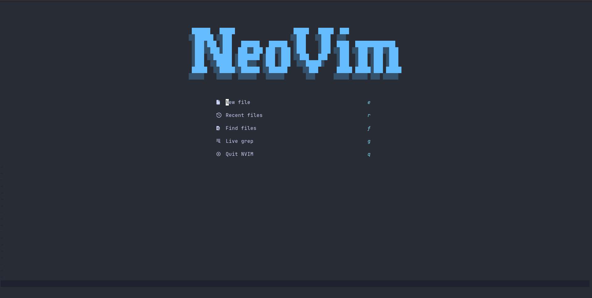

# dotfiles

My dev setup on Fedora: Neovim, tmux and zsh, running in Ghostty.

## What's here

| Path | Goes to |
|---|---|
| `nvim/` | `~/.config/nvim` |
| `.tmux.conf` | `~/.tmux.conf` |
| `.zshrc` | `~/.zshrc` |
| `.tool-versions` | `~/.tool-versions` |
| `gdb/` | `~/.config/gdb` |
| `.gdbinit` | `~/.gdbinit` |
| `clangd/` | `~/.config/clangd` |

## Neovim

Neovim 0.12 with [lazy.nvim](https://github.com/folke/lazy.nvim). Plugins install on first start, or run `:Lazy sync`.

- `lua/core/` has options, keymaps and the LSP setup
- `lua/plugins/` has one file per area (LSP, completion, linting, formatting, telescope, treesitter, UI, git)
- `lua/tlaplus/` is TLA+ support: snippets, completion, `.cfg` checks and highlighting, go to definition, `:TlaCheck` output with TLA+ symbols, and `:TlaPdf` / `:TlaTex`
- `<leader>g` keymaps follow the zsh git aliases (`<leader>gs` is `git status`, `<leader>gph` is push, and so on) and open Neogit

Images and PDFs render inside Neovim through snacks.nvim. That needs a terminal with the kitty graphics protocol (Ghostty, kitty), ImageMagick, and Ghostscript for PDFs.

TLA+ support expects `tla2tools.jar` at `~/.local/share/tla/tla2tools.jar` (set in `.zshrc`), plus `pdflatex` and [tlauc](https://github.com/tlaplus-community/tlauc) for PDFs.

### C and C++

clangd, GCC and gdb, set up for C89 to C23 and C++11 to C++26.

- The language standard follows the code in each file (newest it compiles under) and shows in the statusline. `:CStd c++17` pins one for a project.
- `:CNew` scaffolds an application, application + library, library or header-only library, in C or C++, with CMake or Make, at three tiers: minimal, intermediate (tests, presets, sanitizers, clang-tidy) or robust (hardening, LTO, coverage, benchmarks, docs, CPack, CI).
- `<leader>c` keys configure, build (errors to quickfix), run and test the project, or the current file on its own. `:CAsm` shows the assembly of your own functions, `:CGdb`, `:CPerf` and `:CValgrind` run the program under those tools.
- C++ modules work without a build system: `import std;` and your own modules, partitions included, get completion, hover and go to definition, and build with `<leader>cr`.
- `F5` debugs with gdb's built-in DAP server (`F9` breakpoint, `F10`/`F11` step). The REPL takes gdb commands.
- `snippets/` has C, C++, CMake and Make snippets. The C++ ones note the minimum standard.

`clangd/config.yaml` holds the warnings and clang-tidy checks, `gdb/gdbinit` pretty printing and skipping the standard library when stepping.

## tmux

Plugins go through [tpm](https://github.com/tmux-plugins/tpm). Install it, then press prefix + `I`. `Ctrl+h/j/k/l` moves between tmux panes and Neovim splits. `allow-passthrough` is on so images render inside tmux.

## zsh

Oh My Zsh with the `robbyrussell` theme. Tools it sets up: asdf, pnpm, bun, sdkman, opam and the TLA+ tools.

## asdf

`.tool-versions` pins the global language and tool versions (Elixir, Erlang, Node.js, Python, Go, Ruby, Zig and others). Add each plugin with `asdf plugin add <name>`, then run `asdf install` from your home directory.
